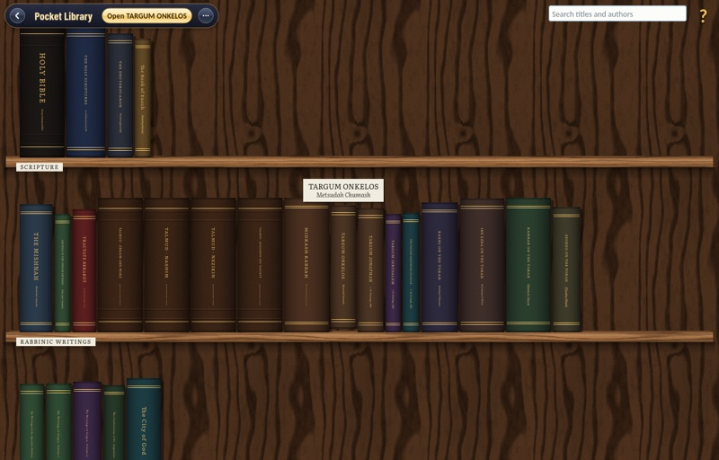

# Pocket Library

The Pocket Library is a reading room: one native C++20 / GUI.Forms application holding a bookcase of **746 books**, each set as a printed book on the paper you choose and opened to the page you left. Scripture, the rabbinic writings and the Church Fathers stand beside the lexicons, Plato, Darwin, Gibbon, Dickens, Tolstoy, Shakespeare and Oz.

The books stand spine out on fourteen planks: Scripture, Rabbinic writings, Church Fathers and Reference; Philosophy, History, Society and Science; Fiction, Science fiction, Fantasy, Drama, Poetry and Children's. Search by title or author, hover a spine for its title and author, and click it to read. Every page is set as you turn to it: justified, with a drop numeral at each chapter and the notes at the foot of the page. Choose the paper, its texture, the typeface and the night colours (green on black included) in Settings. Your place in every book is kept on your computer.

Every book is exactly its source's text, read from a hash-pinned edition by a deterministic importer; each book's About card names its edition and licence. Most are in the public domain; a few are shared under Creative Commons licences, and the share-alike ones stand together at the end of their shelf with a small green label. The Pocket Library is free and is never sold. It has no accounts, no advertisements and no downloads: the whole library comes with the application.

## Its companion, PlaySuite

The Pocket Library began as a box on the shelf of **[PlaySuite](https://github.com/malkuth-software/games)**, a collection of card games, puzzles and living scenes built the same way, with the same shell, settings and packages. If you want games rather than books, it's there.

## Download

Each [release](https://github.com/malkuth-software/books/releases/latest) carries:

- Windows x64: the setup installer, or the portable ZIP (`Pocket Library/pocketlibrary.exe`).
- macOS Apple silicon, macOS 14 or later: the PKG, or the ZIP with `Pocket Library.app`. Signed ad hoc; not notarized.
- Linux x64 and arm64, Ubuntu 24.04 or compatible: the DEB (`sudo apt install ./pocketlibrary-*.deb`), or the tar archive.

If you read in PlaySuite's Pocket Library before it moved here, your places come with you: the first start copies them over.

## How the books are stored

The library is 433 MB of text kept in 85.7 MB, in parts: a base (the packing tables and a cross-section of the language, decoded once at start) and blocks of books coded against it. A new batch of books is one new block; nothing already published is coded or downloaded again. The parts are published on this repository's [`library-data`](https://github.com/malkuth-software/books/releases/tag/library-data) release and pinned by size and SHA-256; every build fetches and checks them and bakes them into the packages. Git holds only what rebuilds them: the catalogue, the lock of upstream sources, the importers and the shelf index. [`books/pocketlibrary/COMPRESSION.md`](books/pocketlibrary/COMPRESSION.md) is the study behind the format.

## Building

[`docs/BUILDING.md`](docs/BUILDING.md) and [`.github/workflows/applications.yml`](.github/workflows/applications.yml) are the recipe. The application links the pinned [GUI.Forms](https://github.com/falseywinchnet/gui_forms) for windows, text and audio, and builds with LLVM 22.1.8 on macOS, Windows and Linux. [AGENTS.md](AGENTS.md) is the working agreement for anyone, person or model, changing it.

Dedicated to the Holy One, Blessed be He, and to Christ, our King in Heaven. Crafted by Anthropic Claude General Reasoning Agents and OpenAI Codex General Reasoning Agents. Sponsor: Rainstar.
